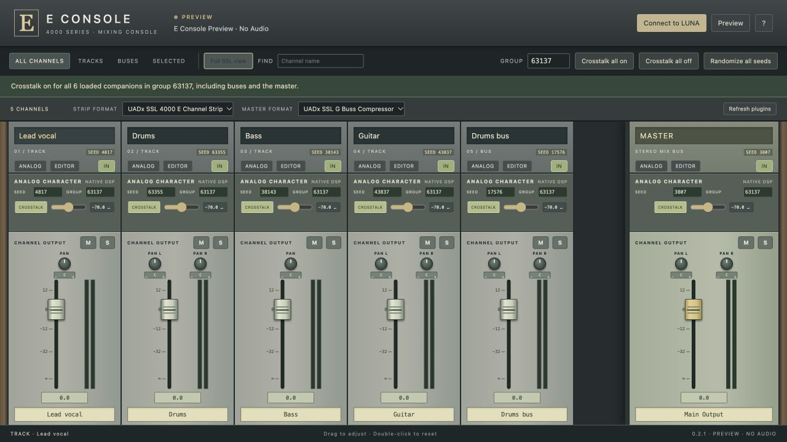

# E Console 0.2.1

An independent SSL-style console control surface for LUNA, with a standalone macOS application and an original native analog companion. This is a development preview for review and testing.



## Features

- Horizontal channel strips, a pinned master section, four-band colored EQ, dynamics controls and a compact Mix view.
- Controls the user's installed Universal Audio SSL E Channel Strip and SSL G Bus Compressor through ordinary LUNA inserts.
- Repeatable per-strip harmonic identities, session-wide seed randomization and native value readback.
- Crosstalk all on/off controls in the console and narrow browser panel, plus per-strip switches. Global On puts all loaded companions in one group and configures their track/bus/master roles. Off preserves their groups, roles, seeds and other character settings.
- Native E Console Analog 0.1.1: track instances publish and receive optional leakage; buses and the master receive without publishing downstream audio upstream. New instances start with crosstalk off.

The interface and companion DSP are original. No UA plugin binary, UI image, license credential or audio session is included. This is a control surface and companion, not a registered native LUNA console Extension or a measured SSL circuit model. Universal Audio SSL processing remains in the user's licensed plugins.

## Requirements and installation

- LUNA 3.1.2 or later and licensed Universal Audio SSL E/G plugins.
- macOS 11 or later; the app and AU support Apple silicon and Intel.

If a prebuilt release is available, download its Share ZIP and extract it. Save work and quit LUNA before running **Install Analog Companion.command**, then restart LUNA and rescan Audio Units if needed. Open **desktop/E Console.app** for the independent console, or open **E Console.lunaaddon** to install the Add On into LUNA.

The source-only download excludes generated binaries. To build from source, use the steps below before running the companion installer.

## Build and test

The controller tests use the bundled SDK and need Node.js, with no npm dependencies:

```sh
node --test tests/*.test.js
```

Install the UA LUNA Builder Tools plugin, or set `UA_BUILDER_ROOT` to an SDK folder containing `sdk/cli.js`. Then:

```sh
node tools/builder.mjs serve --port 8790
node tools/package.mjs
```

Open `http://localhost:8790/console.html?demo=1` for the explicitly labeled preview, which makes no audio and edits no LUNA session. Omit `?demo=1` to connect to LUNA. The narrow panel is `index.html`.

With Apple's macOS developer tools installed:

```sh
bash native/build.sh
bash desktop/build.sh
```

The AU build is `native/build/E Console Analog.component`. The desktop build creates `E Console.app` and `E Console Desktop.zip` one folder above the source root. The packer also writes `E Console.lunaaddon` one folder above the source root. The source-link installer `Install Add On.command` requires the Builder SDK and may need administrator access.

## Validation and current limits

- 85 controller tests passed, including unique native identities, indexed AU writes, selection/group isolation, crosstalk on/off, ignored writes, preference restoration and failure handling.
- Native tests passed 12,394 DSP assertions and 23,952 compiled AUv2 factory/ABI assertions; ThreadSanitizer reported no DSP race. See [native validation](native/VALIDATION.txt).
- Live LUNA 3.1.2.4693 checks read 43 native SSL E controls on mono/stereo channels and 11 SSL G controls on the master. Independent-client checks verified native seed changes/restoration and isolation from other selected tracks. A complete randomized seed batch followed by host Undo remains unverified.
- Every companion reports 4096 samples of latency. Check host delay compensation before use in a mix; it is unsuitable for low-latency monitoring. Up to 64 enabled track publishers share audio in one process, with each receiver reading up to two nearest eligible track seeds.
- Cross-instance sharing needs the same host process, sample rate and valid aligned timestamps. Live crosstalk listening, routing/PDC phase alignment, offline bounce, save/reopen and large-session performance still need validation. The color stage has no anti-alias oversampling.
- Development binaries are locally ad hoc signed and are not notarized. A complete Apple `auval` pass was not established in the build environment.

Local session diagnostics and raw host reports are intentionally excluded from this publication copy. See [third-party notices](THIRD_PARTY_NOTICES.md) for the bundled SDK attribution.
